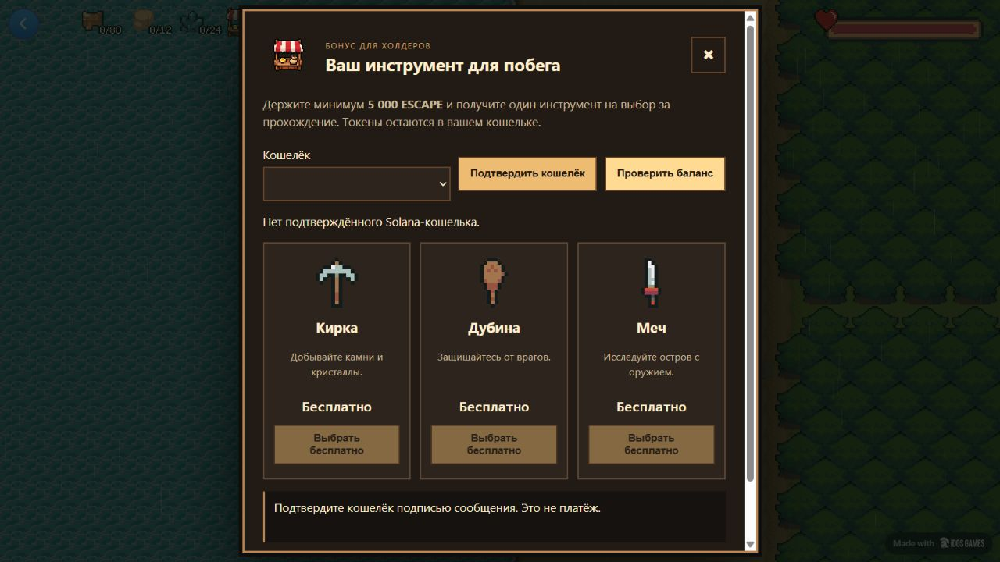
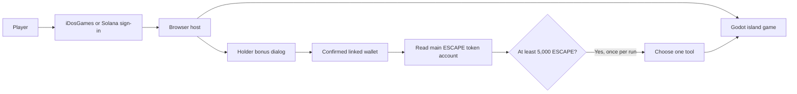

# Escape From A Short Escape

> A free browser survival game: explore an island, gather resources, craft tools, and repair a boat to escape. Holders of 5,000 ESCAPE can choose one free tool per run.

[Play now](https://tjjpkxhe.idos.games/) · [iDosGames page](https://idosgames.com/app/TJJPKXHE/) · [Architecture](docs/architecture.md) · [Roadmap](docs/roadmap.md) · [Demo guide](docs/demo.md)



## Project and team

This repository contains the Godot game and its iDosGames/Solana browser adaptation.

| Contributor | Work |
| --- | --- |
| [gojosatoru999u](https://github.com/gojosatoru999u) | Adaptation owner, iDosGames publishing, Solana holder-bonus integration |
| [nabilmuafa](https://github.com/nabilmuafa) | Original Godot island game |

The original game was created by [nabilmuafa](https://github.com/nabilmuafa/individual-game-jam) for a university game jam. This adaptation adds browser hosting, iDosGames and Solana sign-in, and a token-holder tool bonus. It does not claim authorship of the original gameplay or artwork.

The presentation follows [Marakaya's Colosseum repository example](https://github.com/Marakaya/colosseum_example). A hackathon submission and a demo video have not been published.

## Problem and solution

Wallet-based games can make a token purchase a prerequisite for trying the gameplay. This project keeps the island adventure free while offering an optional holder bonus.

Players can sign in through iDosGames or a Solana wallet and start playing without holding tokens. A wallet holding at least **5,000 ESCAPE** in its main token account can receive a **Pickaxe, Club, or Sword**, once per run. Tokens stay in the wallet; tools can also be crafted using game resources.

## Why Solana

The deployed ESCAPE token lives on Solana mainnet. A read-only RPC request lets the browser check a wallet's token balance without transferring funds or deploying a custom smart contract. Wallet ownership is confirmed through the iDosGames SDK's message-signature flow.

## Summary of features

- Pixel-art island exploration, resource gathering, inventory and crafting.
- Repair a boat and escape the island.
- Free access through iDosGames or Solana wallet sign-in.
- A bonus button beside the resource counters, using the supplied shop icon.
- One tool per run for holding at least 5,000 ESCAPE; fresh balance check when claiming.
- Main-token-account balance validation with integer precision.
- Game pause while the bonus dialog is open; duplicate bonus delivery is blocked.
- No purchases, SOL payments, token transfers, buybacks, or custom on-chain program.

## Tech stack

| Layer | Technology |
| --- | --- |
| Game | Godot 4.3, GDScript, Web export |
| Browser host | TypeScript, React 19, Vite 8 |
| Login and hosting | iDosGames SDK and platform |
| Wallet connection | Phantom / Solflare, iDosGames signed challenge |
| Token read adapter | `@solana/web3.js`, Solana JSON-RPC |
| Verification | Node.js tests, TypeScript checks, Godot runtime checks |

## Architecture



See [architecture and trust boundaries](docs/architecture.md). This is a client-side single-player bonus, not a secure entitlement system for prizes or trading.

## Quick start

Prerequisites: **Godot 4.3** with its matching Web export templates, **Node.js 22+**, npm, and Git.

1. Clone this repository and open `game/project.godot` in Godot 4.3.

   ```sh
   git clone https://github.com/gojosatoru999u/escape-from-a-short-escape.git
   cd escape-from-a-short-escape
   ```

2. To play the original island gameplay locally, run the project in the Godot editor.
3. To run the complete browser adaptation, export the Web preset first:

   ```sh
   mkdir -p web/public/game
   godot --headless --editor --path game --import
   godot --headless --path game --export-release Web
   cd web
   npm ci
   npm run dev
   ```

   On Windows, from the repository root:

   ```powershell
   .\scripts\export-web.ps1 -Godot 'C:\path\to\Godot_v4.3-stable_win64_console.exe'
   Set-Location web
   npm ci
   npm run dev
   ```

4. Open the URL printed by Vite. The host is configured for the existing iDosGames title `TJJPKXHE`. Sign in through iDosGames, or use Chrome with Phantom/Solflare for wallet flows.

Godot export creates `web/public/game/index.js`, `.wasm`, and `.pck`. Generated exports are excluded from Git. iDosGames service calls require an internet connection; a different publisher's deployment needs its own title and platform configuration.

## Tests and web build

```sh
cd web
npm ci
npm run typecheck
node --test tests/holder-bonus.test.mjs
npm run build
```

The five test groups cover the exact threshold, token-account derivation and validation, RPC failures, fresh claim checks, inventory limits, introduction state, one choice per run, reset, and absent linked wallets. The local `tests/runtime.html` harness uses an explicitly simulated linked-wallet response and a real read-only RPC query; it is excluded from the production bundle.

For a deployable package, first export Godot and build the web host, then run `web/scripts/package.ps1`. See [deployment](docs/deployment.md). CI runs the TypeScript and holder-bonus checks; it does not deploy the game.

## Token and bonus rules

| Setting | Value |
| --- | --- |
| Network | Solana mainnet |
| Token | Short Escape / ESCAPE |
| Mint | `BTfVrZYGHJs8RAMRgfPaioc33WaU8ZweCQbiy5h7idos` |
| Decimals | 6 |
| Bonus threshold | 5,000 ESCAPE |
| Choices | Pickaxe, Club, Sword |
| Limit | One selected tool per run |
| Token spending | None |

The free RPC checks the canonical associated token account (ATA). Additional token accounts, balances on exchanges, and staked balances are not included. A claimed item remains for the rest of the run even if the tokens are later transferred. A new game rechecks the balance.

## Roadmap

- [x] Adapt the Godot game to browser play.
- [x] Publish the free game on iDosGames.
- [x] Add iDosGames / Solana sign-in.
- [x] Replace purchases with a free holder bonus.
- [x] Validate bonus rules and Godot inventory delivery.
- [ ] Complete human testing of wallet signatures and linking in Phantom and Solflare.
- [ ] Improve mobile controls and test more devices.
- [ ] Record a short gameplay demo.
- [ ] Consider server verification only if future rewards have monetary value.

## Attribution and licenses

The upstream game has **no top-level license**. This repository does not apply an MIT license to the original game or its assets. See [attribution](docs/attribution.md), the [upstream README](docs/upstream-readme.md), and the bundled dependency/asset license files.

This is an adaptation of an existing game, not a claim that the original game was created for a new hackathon. No traction, revenue, security audit, or completed hackathon entry is claimed.
